# omaviz — if you liked Winamp, you'll love omaviz even more

The spectrum analyzer you stared at for hours in 1999 — reborn as a
native citizen of your Omarchy desktop. Live bars in your waybar, a full
desktop visualizer window, and an oscilloscope that dances to whatever
is playing. Same soul, zero nostalgia tax: native GPU rendering,
theme-aware, and configured from the bar.

 

## Why omaviz

- **It lives where you look.** No separate app to open — the visualizer
  is always there, in the bar, pulsing with your music, your calls,
  your game.
- **One click to tweak, one more to go big.** The settings panel
  shows a live preview of every change — click that preview and the same
  visualization explodes onto a borderless desktop window.
- **Your colors, everywhere.** Follow the Omarchy theme automatically,
  or dial in your own From → To gradient — mini, preview, desktop and
  waveform all stay in sync.
- **Deaf to players, loyal to sound.** It listens at the PipeWire monitor,
  so it visualizes *everything* — Spotify, browser, games, calls, local
  files. No player plugins, no per-app setup, no exceptions.
- **Winamp physics, not a slideshow.** Peak-hold markers with accelerating
  fall, instant-rise linear mode, flame gradients, segmented stacks —
  the motion language your muscle memory already knows.

## The tour

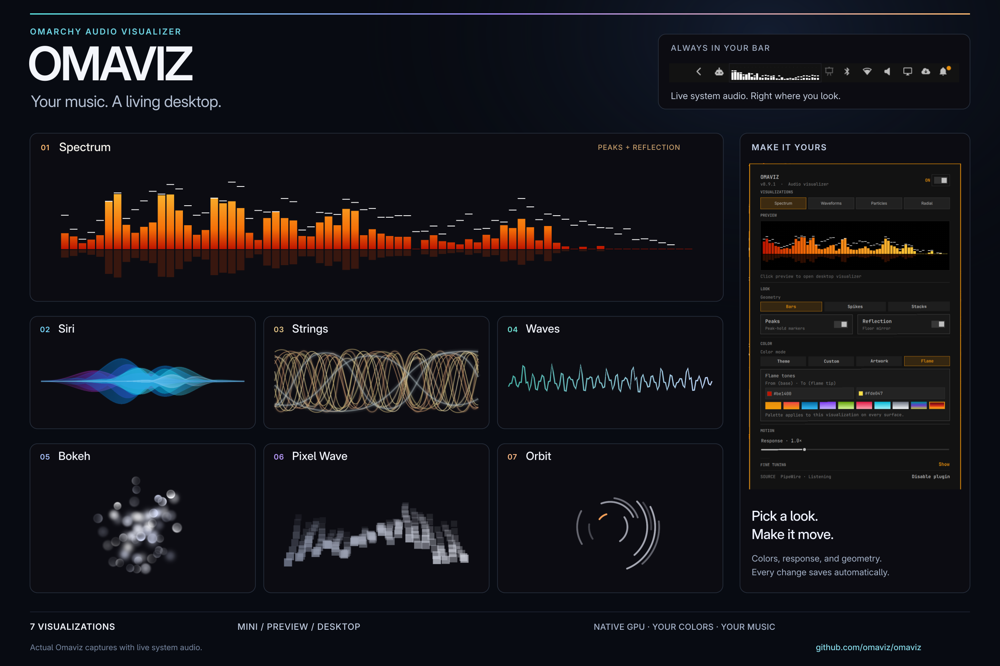

All ten visualizations below use the production renderer driven by **live PipeWire
system audio**. The bar and settings images are actual installed v8.10.1 screenshots.
The [capture manifest](docs/screenshots/marketing/captures.json) records the source,
dimensions, timestamps, audible frame counts, and renderer digest. Screenshots keep
their original proportions; the preview layout does not repaint the visualizations.

<details>
<summary>All ten visualizations — live captures</summary>

| | |
|---|---|
| 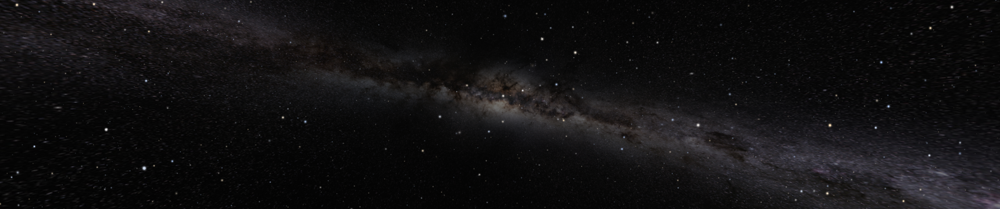 | 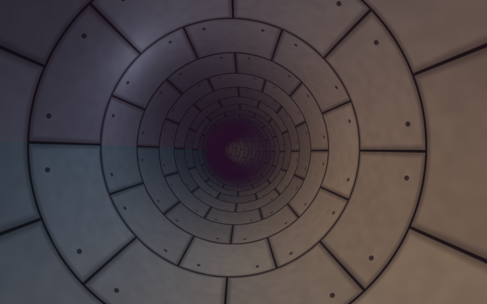 |
| **Cosmos** | **Tunnel** |
| 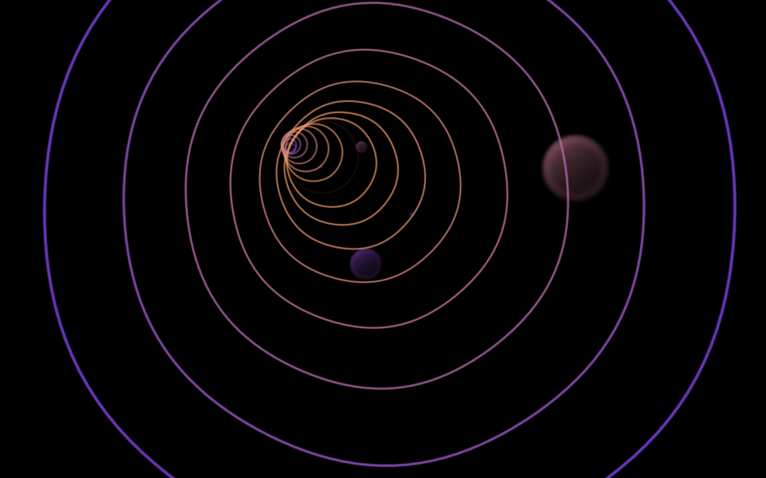 | 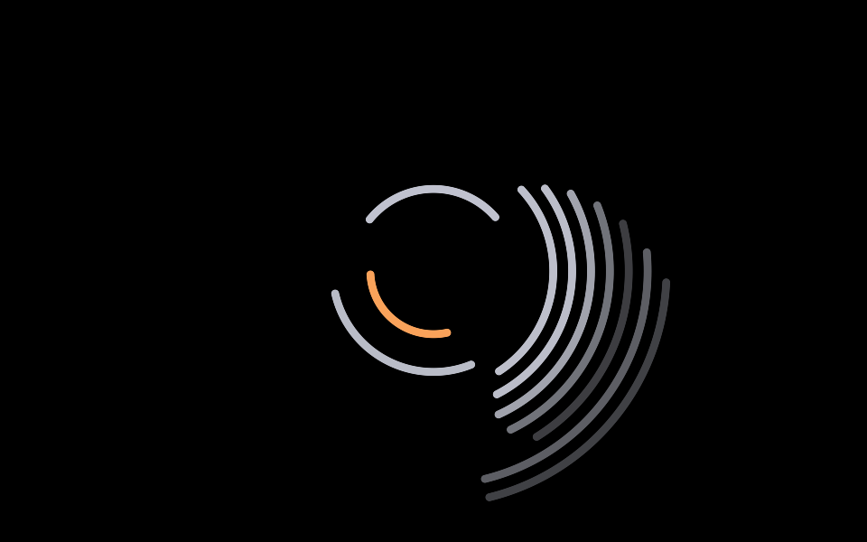 |
| **Spiral** | **Orbit** |
| 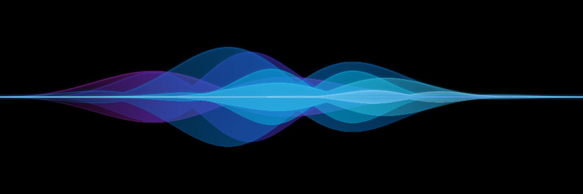 | 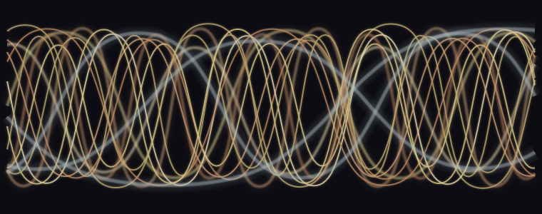 |
| **Siri** | **Strings** |
| 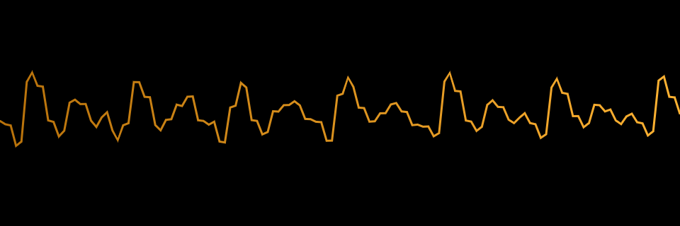 | 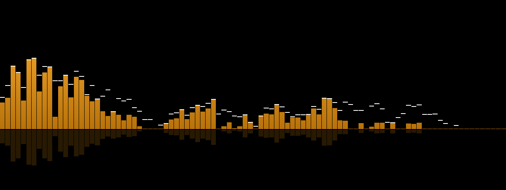 |
| **Waves** | **Spectrum** |
| 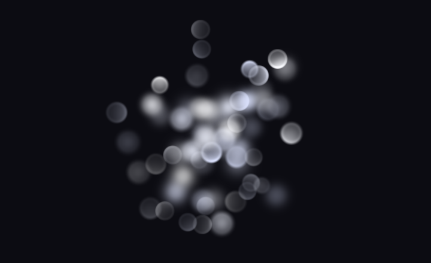 | 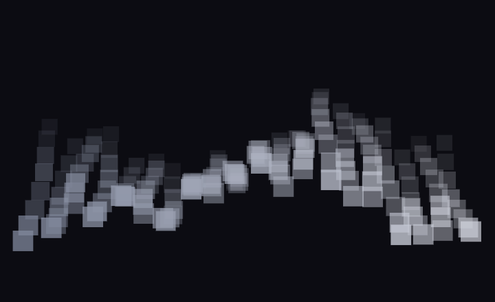 |
| **Bokeh** | **Pixel Wave** |

Milky Way photograph: [ESO/S. Brunier](https://www.eso.org/public/images/eso0932a/),
[CC BY 4.0](https://creativecommons.org/licenses/by/4.0/). Cosmos projects and dims the
photograph and optionally tints its core; the foreground stars are procedural.

</details>

<details>
<summary>More Spectrum and Siri styles — live captures</summary>

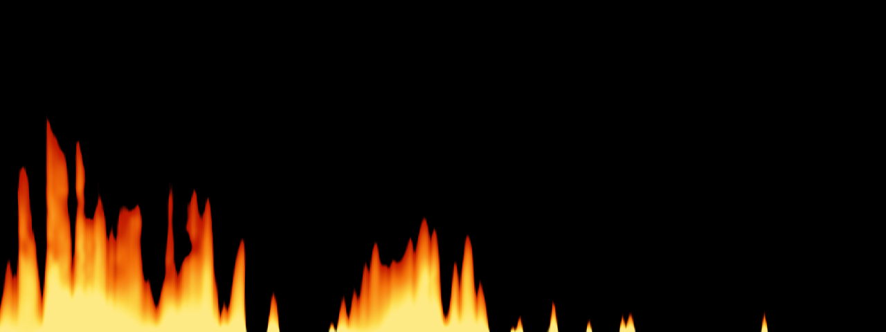
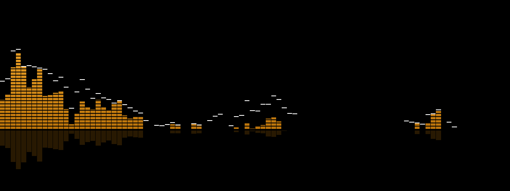
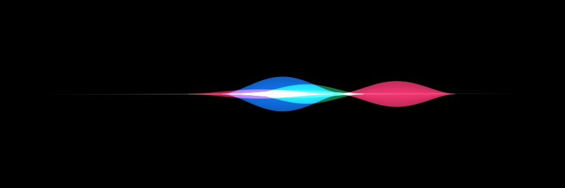

</details>

<details>
<summary>Current settings panel</summary>

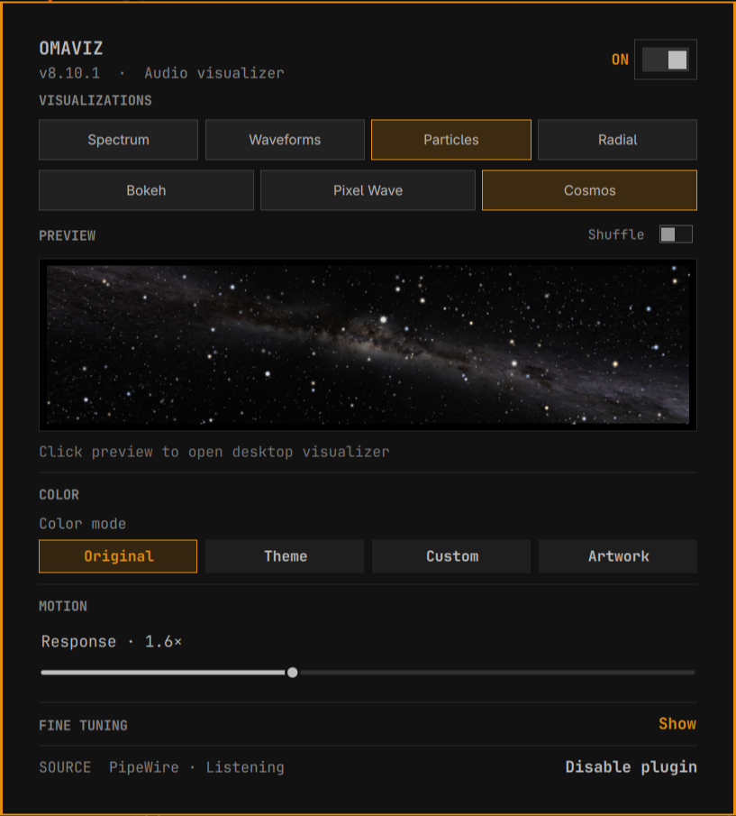

</details>

## Features

- **Mini** — 32 bars in the bar (128-band engine feed, max-downsampled),
  with a dotted-skin backdrop and a B&W Mono mode for tiny sizes
- **Spectrum** — peaks + fall speed, Spikes rendered as turbulent rising flames, Fire flame gradient,
  Winamp Stacks, floor-mirror Reflection, album-art backdrop.
  Spikes uses a continuous audio-fed flame field with rising multi-scale noise, curling tips, transparent edges, and a hot core. It preserves palette and monochrome support; peak caps belong to Bars/Stacks. The approach is informed by [NVIDIA’s distortion-based fire rendering](https://developer.nvidia.com/gpugems/gpugems/part-i-natural-effects/chapter-6-fire-vulcan-demo).
  The experimental retained renderer is enabled in this build (`OMAVIZ_SPECTRUM_RETAINED=0` disables it);
  it preserves peak physics and 60 Hz animation, but has not met the 50% performance target.
- **Waves** — 128-point peak-preserving waveform envelope, adjustable
  thickness, follows your colors
- **Bar color** — theme-dominant by default (tracks Omarchy theme
  switches live), or custom From → To tones via presets or hex
- **Strings** — gold and cream strands rotate around a uniform pipe that grows taller with music energy; some strands soften near the outer arcs, with broad blurred blue strands in front. Spectral bands pulse each strand's radius while waveform samples ripple the loops. Small surfaces use fewer strands to retain separation. The backdrop stays transparent.
  A retained GPU mesh preserves the existing curves and glow; the feed carries the 16 strand excitation values plus the full waveform.
- **Particles** — **Bokeh** breathes with audio loudness, with drifting discs and changing focus; **Pixel Wave** shapes its front from the music waveform and spectrum, sending captured rows into a shrinking, fading tail. Both simplify at mini sizes.
- **Cosmos** (Particles) — continuous forward flight through stars with parallax and restrained glow, a real Milky Way panorama with dust lanes, and small distant galaxies near the edges. Stars scale up for desktop windows and gradually brighten as they approach. The dense star population stays fixed; music controls travel speed. Both star layers move with depth, with distant stars drifting more slowly than nearby stars. Stars retain natural colors independently of the palette (except explicit monochrome). The central bulge follows the selected palette; Original preserves the photograph’s natural color. Photograph: [ESO/S. Brunier](https://www.eso.org/public/images/eso0932a/), [CC BY 4.0](https://creativecommons.org/licenses/by/4.0/); projected, dimmed, and optionally tinted at runtime. There is no edge vignette. Foreground stars have soft circular halos with transparent outer bounds. The fixed population has 3840 stars on larger surfaces and 320 in the mini. Image credits appear below the right-hand actions in the compact, square desktop hover panel at the bottom center; artwork and track details occupy its left section. The panel is up to 480px wide, places track/artist/album details beside the poster, and puts actions in its top-right corner. It fades after 30 seconds without mouse activity and returns on pointer movement or Tab. Narrow windows put details beneath the action row; full metadata remains available in a tooltip.
- **Radial** — **Orbit** sways an outer arc group with independently articulating inner arcs, audio-driven length and brightness. **Tunnel** travels through a curved passage lined with staggered concrete blocks, recessed joints, and bolt pockets, with diffuse light, a steady camera, and broad turns that grow with smoothed music intensity. **Spiral** descends through luminous rings and floating pearls without a background starfield; its ring population grows with music to a maximum of 22 (12 in the mini). Music energy drives the descent, bass gently breathes through the Spiral rings, and treble lights the pearls. Choose Original for cyan, violet, and warm gold, or use Theme, Custom, or Artwork colors.
  These modes use retained GPU meshes and custom shaders, with Original, Theme, Custom, and Artwork colors, per-visual settings, Response, mini monochrome, and optional blurred artwork backdrops. Original matches the reference silver/white particles and warm-accented arcs. They fade and settle during silence.
- **Siri** — the existing cyan/blue/violet ribbons remain the default. Select **Classic Siri** in the style selector, for independently appearing, mirrored color lobes on a fine neutral axis, based on the classic Siri reference. Red, green, blue, and cyan overlaps brighten toward white; custom palettes and monochrome remain supported.
  Six spectral envelopes control the response without a shared minimum height. Lobes have separate lifetimes, widths, and prominence, and disappear into the baseline during pauses. Their shape stays in GPU memory at 60 Hz. Enable **Left to right motion** under **Motion** to add sideways travel; default motion expands and contracts in place.
- **Shuffle on track change** — in the preview header, with the label on the left and a compact Shuffle toggle on the right, without helper text. Track changes choose another mode with suitable palette, geometry, and Siri style variations, fading out for 500ms and in for 700ms. Temporary choices preserve saved looks; switching Shuffle off restores the prior selection. Selecting a mode manually also stops Shuffle.
- **Motion** — Winamp-style linear fall by default, optional exponential easing,
  adjustable sensitivity
- **Robust** — desktop lease stored separately from settings (no heartbeat overwrites),
  engine auto-retry, one shared GPU renderer everywhere.

## Controls and automatic settings

Choose a category, then a visualization. Groups with fewer than five choices use
selectable buttons; larger groups use a dropdown. There is no search field.
Each category remembers its last selection, and each visualization restores its
own palette, geometry and response. Every edit saves automatically and survives
closing and reopening. Choosing a palette other than Artwork also removes
the artwork backdrop; its separate toggle can re-enable it. There are no Save, Restore or Reset actions. Palette
swatches change only the colors; selection buttons have square corners.

The desktop has a subtle translucent panel with a poster thumbnail, track text,
and the player's available Previous / Play or Pause / Next actions. Close stays
at the far right. Artwork colors and transport follow the same selected player.
Tab reveals the controls. F11 toggles fullscreen; Escape leaves fullscreen or
closes the normal window. Ctrl+Left/Right changes visualization through the
running Omarchy shell. Normal window dimensions are remembered separately from
visual settings.

The mini retains its original lower-density spectrum mapping and bar counts.
Capture preserves channel power before combining spectra, so
opposite-phase stereo does not cancel. Waveforms show the strongest channel's
window. A bounded capture mailbox discards oldest audio under overload.

A four-second valid-spectrum deadline clears stalled visuals and retries the
engine; quiet audio is still healthy. The source status distinguishes connecting,
listening, quiet and recovering states.

## Install

Requires Omarchy (Quickshell), Qt 6.11 or newer, a modern accelerated Qt Quick backend (OpenGL 3.3+ or equivalent), and PipeWire. The bundled native renderer targets Linux x86_64. **Nothing has to be built or run by
hand** — the engine binary ships committed, and Omarchy installs the plugin as
a self-contained folder.

### From the plugin marketplace (recommended)

Install from the Omarchy plugin marketplace, or equivalently:

```bash
omarchy plugin add https://github.com/omaviz/omaviz --enable
```

The original marketplace issue uses **Widgets** with `bar`, `media`, and
`quickshell` tags; the manifest's **Audio** category is Omarchy's separate
bar-widget field. The current listing is already published. For later merges,
the Marketplace preflight workflow validates local submission inputs and
attaches an exact-commit update form for review. Run
`MARKETPLACE_COMMIT="$(git rev-parse origin/master)" node tools/marketplace-update.cjs`
for its body and add `--title` for its title. Each new upstream commit still
needs the marketplace's own validation,
security baseline, and maintainer decision; local CI cannot grant approval.

That is the entire install. `omarchy plugin add` clones this repository,
validates it, and moves the folder into
`~/.config/omarchy/plugins/org.omaviz.visualizer/` — **no script from this
repository is executed, and there is nothing to run afterwards.** The engine
ships as a committed executable at `bin/omaviz-engine` (git mode `100755`, so
the exec bit survives the clone), and the bar widget spawns it from that path
as soon as it mounts.

Removing it is the standard manager operation — its own tool, not ours:

```bash
omarchy plugin remove org.omaviz.visualizer
```

There is no `manual-setup` step. If you ever see no bars, check
`omarchy plugin list` shows the plugin enabled.

### Local development / manual clone

`install.sh` is a convenience for working on omaviz from a git checkout. It is
**not** part of the marketplace install path and never runs during one.

```bash
./install.sh            # copy into the plugin dir, enable, restart the shell
./install.sh --build    # same, but rebuild the engine from Rust source first
./uninstall.sh          # remove the plugin (+ launcher); --purge also config
```

Both scripts are ownership-guarded: they never delete or replace files omaviz
does not own, and uninstall removes only what this plugin installed
(`tests/installer.test.sh` proves it).

Requires: Omarchy (quickshell), Qt 6.11+, PipeWire. Maintainer builds use Cargo, CMake, a C++17 compiler, Qt Quick development files and Qt Shader Tools. `./build.sh` builds both the Rust engine and the native renderer; users receive both binaries.

## Testing

```bash
npm test              # all JS/QML suites (node >= 24)
npm run test:rust     # engine unit and source integration tests (locked Cargo)
npm run lint:rust     # Clippy, all targets, warnings are errors
npm run verify        # JS, installer safety, and Rust
npm run test:qml      # real settings, desktop, and catalog feed transitions
npm run test:render   # native modes/transitions and cached-artwork pixel removal
python tests/catalog-visual.py renderer/build/omaviz-render-probe /tmp/omaviz-catalog # bounded native captures
```

| Suite | What it proves |
| --- | --- |
| `tests/modelstore.test.cjs` | config defaults/schema, TOML round-trips, the store funnel (get/set/onChanged) |
| `tests/physics.test.cjs` | the shared motion model: instant attack, rate-limited release, peak sustain + accelerating fall |
| `tests/qml.test.cjs` | Qt 6 syntax check; real components/native controls cover runtime behavior |
| `tests/engine.test.cjs` | drives the committed binary and asserts its frame contract (finite samples, feed layouts, faint-signal handling) |
| `tests/pixel-music.cjs` | verifies held audio stays flat and equal-energy frequency changes reshape Pixel Wave on the GPU backend |
| `tests/artwork-backdrop.cjs` | executes the production palette action and verifies cached artwork pixels disappear on the GPU backend |
| `engine/` (cargo) | DSP + frame + source unit tests and fresh-engine replay integration |

**Safety:** the installer never deletes files it doesn't own. A plugin
directory that isn't omaviz-managed (no `.omaviz-managed` marker) is left
untouched unless you pass `--force` (which takes a timestamped backup
first). An incoming runtime filename that collides with an unowned file or directory
is refused before any managed file is removed; `--force` backs up the entire
old plugin directory. Foreign files inside a managed install — and unrelated
`.desktop` launchers — always survive install, update, and uninstall.

Single-click the mini for settings · single-click the preview inside it to
detach the desktop window · close it and the mini returns by itself.

## Mini

Thirty-two live bars riding in your bar, fed by the 128-band engine —
with a dotted-skin backdrop and a B&W Mono mode for tiny sizes.
Single-click the mini for the settings panel below; single-click the live
preview inside it to detach the desktop window:


## Engine

The Rust engine lives *inside* the plugin and is fully managed —
spawned, restarted and retired by the bar widget itself. There is
nothing to configure, no service to enable, no socket to babysit:
install and it just runs. Rebuild from source only if you want to
hack on it (`./install.sh --build`).

```bash
omaviz-engine --bands 128 --fft-size 2048 --wave
```

One JSON frame per line on stdout (`bands, energy, beat, silent, source,
t`) plus `{wave:[...]}` lines with `--wave`. Emits on fresh audio with a
5Hz heartbeat; explicit zero-silence 2s after capture death.

## Layout

Repo root **is** the plugin (`manifest.json` lives here, per the
marketplace rules) — dev-only baggage (`engine/`, `docs/`, scripts)
is excluded at install time:

```
manifest.json    # plugin identity (id, version, entry points)
BarWidget.qml    # bar mini + engine spawn + all config writes
Panel.qml        # settings panel (preview + options)
Desktop.qml      # detached window (standalone quickshell -p, NO qs.* imports)
VisualCanvas.qml # shared display clock, physics and rendering API
renderer/        # native batched Qt Quick geometry source
native/          # bundled QML plugin (all modes, all surfaces)
ModelStore.js    # config store: parse/write, defaults, reactive get/set, spectrum parse
Physics.js       # shared bar/peak motion model (unit-tested)
assets/ bin/ tests/  # launcher entry, COMMITTED engine binary, node tests
engine/          # Rust source: PipeWire capture → FFT → bands + wave frames
install.sh / build.sh / uninstall.sh
APP_SPEC.md  # full spec
```

Installs to `~/.config/omarchy/plugins/org.omaviz.visualizer/`.

## Docs

- `APP_SPEC.md` — architecture, config keys, lifecycle
- `docs/AGENTS.md` — rules for AI agents working in this repo

## Open source

> **Audio stays local.** No trackers or analytics. The engine analyzes local
> audio without uploading it. Player-provided HTTP/HTTPS cover URLs are fetched
> to display artwork or extract its colors; those requests contact the artwork
> host. Local file artwork stays local.

Artwork fetching is bounded to 12 MiB and a ten-second deadline. The decoder accepts
PNG, JPEG, and WebP when supported by Qt, with at most 4,194,304 source pixels and
8,192 pixels per dimension. PNG text, compressed profiles, and other non-pixel
metadata are removed **before** decoding. Only metadata-free thumbnails of at most
192×192 reach QML's poster and backdrop images; unsupported or oversized artwork
falls back to the placeholder/theme colors. The shared shell's global image limits
are unchanged. [Marketplace review evidence](docs/REVIEW-8.10.1.md).

MIT-licensed and hackable end to end: QML surfaces, shared GPU
renderer and the Rust PipeWire engine all live in this repo, with
`APP_SPEC.md` as the design record and tests for both sides
(`tests`, `cargo test`). Found a rough edge or a missing
Winamp-ism? Issues and PRs welcome — the tour screenshots above are
all taken from the live plugin, so what you see is what runs.

Settings saves are serialized so rapid selections remain applied. Flame has independent
`fire_color_from` / `fire_color_to` colors; changing custom swatches preserves them.
Desktop liveness lives in `desktop-state.toml` alongside `config.toml`.

GPU migration acceptance and CPU/GPU budgets are tracked in [GPU_PLAN.md](GPU_PLAN.md). Resource targets require live measurements; passing unit tests alone does not establish them.

### Minimal settings and playback controls

Choose Spectrum or Waveforms from the top dropdown. Waveforms offers Waves (the oscilloscope),
Strings, and Siri in a second dropdown. Only relevant controls appear.
Fine tuning starts collapsed. The larger live preview sits at the bottom on
a pure black background. Custom colors support editable start/end hex values
and an optional middle color across mini, preview, and desktop; presets return
to two colors. The Peacock preset adds teal, violet, and gold; Strings supports
the same custom colors. Spectrum’s Artwork mode extracts cover colors for both
the bars and the desktop’s blurred, tinted background, with theme colors as a
fallback when artwork is unavailable. The desktop hover card shows artwork and track details, with
play/pause when the active media player supports it.

Off pauses visualization and capture while keeping the plugin and desktop controls
available. On resumes in place. Disable plugin closes the desktop, stops Omaviz capture,
and unloads the plugin from the shared shell. Desktop settings apply on completed
file loads, with a 250ms polling fallback. Hover controls fade after 30 seconds of pointer inactivity, including stationary hover over buttons, and the controlled media player stays selected after Pause.

Native visual regression: after building with `OMAVIZ_RENDER_PROBE=ON`, run
`tests/renderer-visual.sh /path/to/omaviz-render-probe` in a graphical session.
Each mode or transition probe closes after three seconds and checks visible color
coverage, including Spectrum receiving its first bands after startup. Screenshots
are kept in the reported temporary directory for visual review.

Keyboard controls: use Tab to reach settings, Space/Enter to activate choices,
and arrow keys or Home/End to adjust sliders. Focused settings scroll into view.
In the desktop visualizer, Tab reveals playback/close controls; they remain
visible until the 30-second inactivity deadline. Pointer movement and playback actions
restart the deadline. The desktop minimum size is 320×160 to keep actions usable.

Run `npm run test:interactions` on an Omarchy development machine for Qt mouse
and keyboard regression tests. The tests extract current controls from the QML;
shell theme decoration and the media player are isolated fixtures.

Desktop Waves and Siri preserve a centered 3:1 silhouette. Strings fills the
window with broader, more responsive curves. Spectrum fills the window with
bars that grow wider as the desktop grows instead of staying tiny.

### Settings and capture reliability

The preview sits beside visualization selection. Response spans 0.1–4×; numeric
controls display their current values without an enclosing card. Save failures
and invalid hex colors show inline feedback. “Disable plugin” removes the widget
from the active shell; the ON/OFF switch only pauses visualization.

Capture preserves all queued PCM buffers and honors SPA offsets/strides. A lost
PipeWire connection exits the engine so the host can retry. Waveform samples are
ordered bucket minima/maxima; full-window RMS travels separately for consistent
Strings expansion and waveform normalization. Older waveform frames still work.

`npm run test:render` builds the native module and runs bounded offscreen OpenGL
captures, checking visible output and shader failures. It requires OpenGL 3.3.
Local builds installed during development are not CI-attested release binaries.

Hex colors accept six typed digits (Enter applies, Escape cancels). Clipboard paste
is deliberately unavailable: no Qt text editor is instantiated or clipboard read
performed, including while the settings panel is hidden.

Launching **Omaviz** re-enables a disabled plugin before opening the desktop.
The mini and desktop animate together. The Rust engine remains at v8.9.1.

To regenerate the live gallery on an Omarchy development machine, play music and run:

```bash
cmake -S renderer -B renderer/build -DOMAVIZ_RENDER_PROBE=ON -DCMAKE_BUILD_TYPE=Release
cmake --build renderer/build --parallel 2
python3 tools/capture-preview.py
python3 tools/render-preview.py
```

`capture-preview.py` opens only bounded native capture surfaces and never writes
user settings. It requires live PipeWire input and refuses silent/synthetic captures.
Mini and Settings must be refreshed from the installed desktop with `grim`; keep
surrounding applications out of those crops and update their capture-manifest entries.
